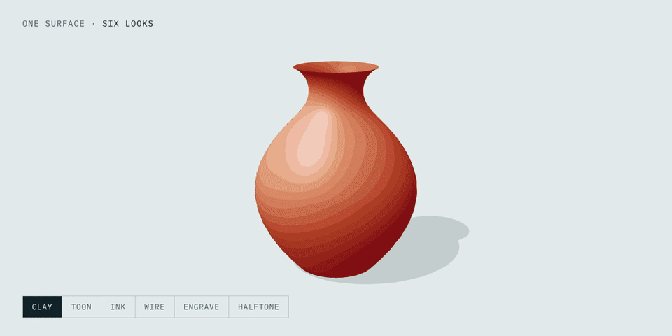
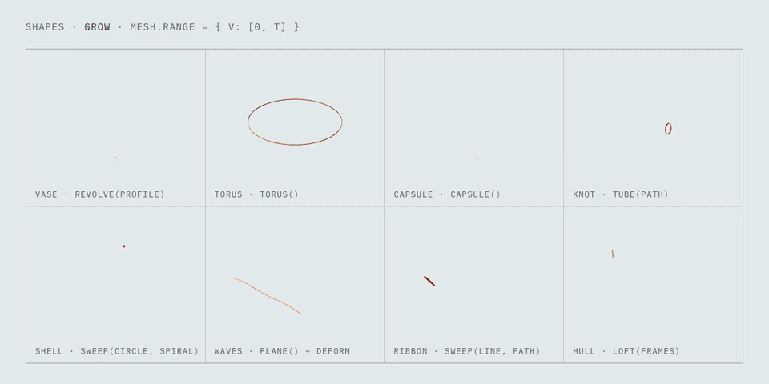
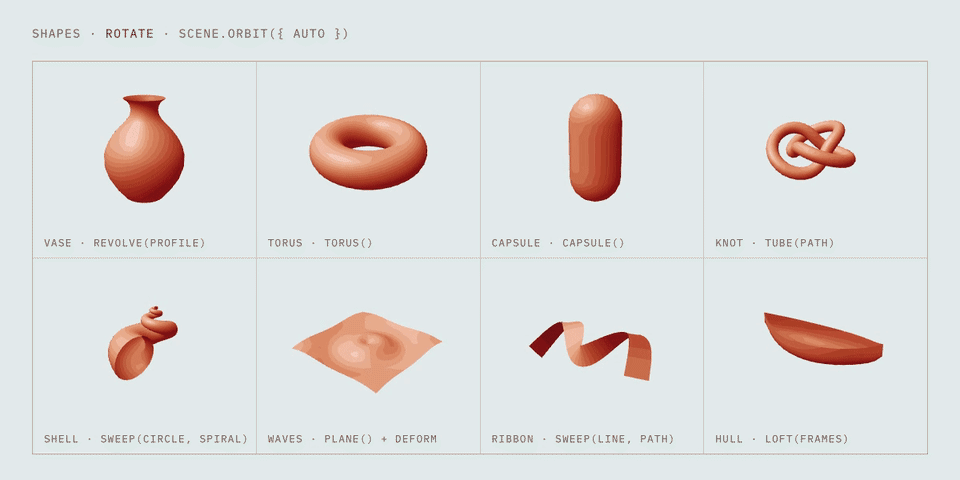
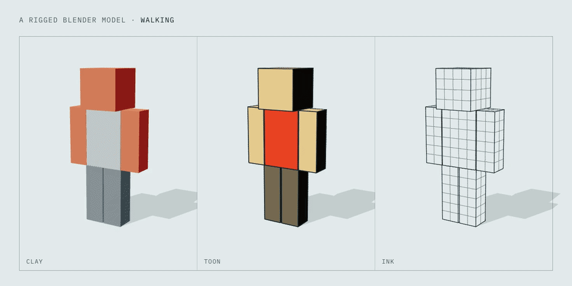
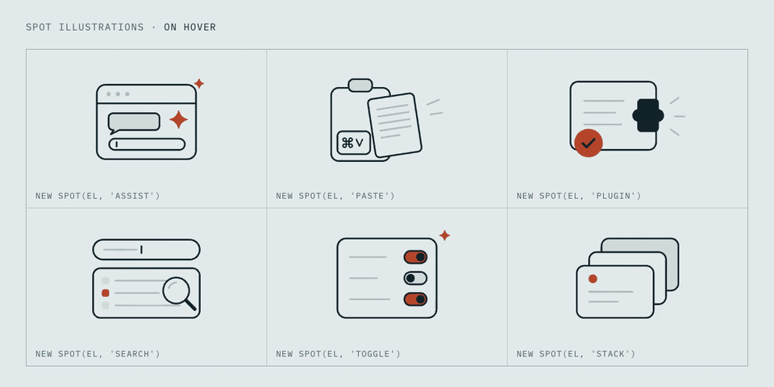

# Loft

3D illustrations and animations for the web, drawn as plain SVG. No canvas, no WebGL, no dependencies.

**[Live demo](https://uxmatthew.github.io/Loft-3D-SVG/demo/)**



Loft builds shapes from NURBS (the curves and surfaces CAD software uses) and draws them as SVG `<path>` elements. The result scales like type, takes its colours from your CSS, prints as vectors, and can be rendered to a string on a server.

```js
import { Scene, shapes } from './dist/loft.js';

const scene = new Scene('#stage', { label: 'A vase, turning' });
scene.add(shapes.vase(), 'clay');
scene.orbit({ auto: 0.3 });
```

## Examples

Every animation here is drawn by Loft itself, frame by frame, as SVG.

**Shapes, one call each, that grow, morph and turn.** Grow animates how much of a surface is drawn; morph blends one control net into another built the same way; rotate turns the scene.






**A rigged Blender model.** Six boxes hanging from six bones, read out of a `.blend` file and drawn as closed surfaces of degree 1, so every look treats them the way it treats a vase.



**Spot illustrations.** Small flat pictures of interface ideas whose parts stand apart in depth and move on hover.



### The demo page

Open `demo/index.html` in a browser to try all of it: it loads `dist/loft.global.js` and needs no server. The home page leads to two groups, **UI** (the spot illustrations) and **Objects** (the shape morph, the shapes with their hover motions, and the rigged model in every look and layer). The bar at the top picks a design system for the whole page — Studio, Pulp, Drafting, Blueprint, Banknote or Print — and each one sets the look every drawing is made in, the accent colour for light and dark, the display face, line weights and colours, and the motion: speed, easing and how far the spots lean. It shows how one set of drawings takes on a brand. The button in the corner switches between light, dark and the system's theme. A sheet's scenes are built the first time it is opened, and the address names the sheet, so `demo/index.html#model` opens the Model sheet.

## Contents

- [Examples](#examples)
- [Install](#install)
- [How it works](#how-it-works)
- [Making shapes](#making-shapes)
- [Looks and materials](#looks-and-materials)
- [Scenes](#scenes)
- [Motion](#motion)
- [Spot illustrations](#spot-illustrations)
- [What is built in](#what-is-built-in)
- [Theming](#theming)
- [Rendering to a string](#rendering-to-a-string)
- [The `<loft-scene>` element](#the-loft-scene-element)
- [The mathematics](#the-mathematics)
- [Limits](#limits)
- [Development](#development)

## Install

The package is not published to npm. Use the built files in `dist/`:

| File | Use |
| --- | --- |
| `dist/loft.js` | ES module, readable |
| `dist/loft.min.js` | ES module, minified (about 37 kB gzipped) |
| `dist/loft-element.js` | ES module that also registers `<loft-scene>` |
| `dist/loft.global.js` | Classic script: defines `window.Loft` and registers `<loft-scene>` |

TypeScript definitions are in `types/index.d.ts`.

## How it works

1. A surface is stored as a small grid of control points, weights and two knot vectors.
2. Each frame the surface is sampled into a grid of points. The basis functions are tabulated once, so moving control points afterwards is cheap.
3. Each grid cell is shaded and, where it spans several tones, cut along the tone contours so shading has smooth edges.
4. Facets, lines and dots are sorted far to near (SVG has no depth buffer) and neighbours with the same style are merged into one `<path>`.
5. Paths are reused between frames; only their `d` and `class` attributes change.

## Making shapes

Every constructor returns a `NurbsCurve` or `NurbsSurface`. Angles are radians. Y is up.

### Curves

| Call | Gives |
| --- | --- |
| `line(a, b)` | A straight segment |
| `polyline(points, { closed })` | Straight segments with sharp corners |
| `curve(points, { degree, closed, weights })` | A B-spline pulled toward its control points |
| `interpolate(points, { degree })` | A smooth curve through every point |
| `arc({ center, radius, start, end })` | An exact circular or elliptical arc |
| `circle({ radius, center, normal })` | An exact circle |
| `joinCurves([a, b, …])` | One curve from pieces that meet end to end |

### Surfaces

| Call | Gives |
| --- | --- |
| `revolve(profile, { axis, angle })` | A profile spun around an axis: vases, bowls, domes |
| `sweep(profile, path, { scale, twist })` | A profile carried along a path: horns, ribbons |
| `tube(path, { radius })` | A round tube along a path |
| `loft(sections, { degree, interpolate, closed })` | A skin over a row of section curves |
| `extrude(profile, vector)` | A profile pushed in a straight line |
| `ruled(a, b)` | Straight lines between two curves |
| `surface(grid, { closedU, closedV })` | A surface from a grid of control points |
| `plane`, `sphere`, `torus`, `cylinder`, `cone`, `capsule` | The usual solids, exact |

`shapes` holds ready-made starting points: `vase`, `knot`, `shell`, `blob`, `ribbon`, `sheet`, `hull`.

```js
import { interpolate, line, joinCurves, revolve } from './dist/loft.js';

// A goblet: a flat foot, then a smooth body through four points.
const body = interpolate([[0.5, -1, 0], [0.1, -0.4, 0], [0.6, 0.4, 0], [0.5, 1, 0]]);
const goblet = revolve(joinCurves([line([0, -1, 0], [0.5, -1, 0]), body]));
```

### Editing

```js
surface.setPoint(i, j, [x, y, z]);   // move a control point
surface.setWeight(i, j, 2.5);        // make it pull harder
surface.point(u, v);                 // a point on the surface
surface.normal(u, v);                // its unit normal
surface.isoCurve('u', 0.5);          // the curve where u is fixed
surface.transform(math.scaling(2));  // a transformed copy
```

Shape-preserving operations: `insertKnot`, `refineCurve`, `refineSurface`, `subcurve`, `splitCurve`, `toBezier`, `elevateDegree`, `makeCompatible`.

## Looks and materials

A material has up to four layers. A look is a tuned combination of them.

| Look | What it draws |
| --- | --- |
| `clay` | Soft matte shading |
| `toon` | Pulp-poster cel shading in seven flat tones: black, olive, khaki, a vermilion band, tan, sand and cream, with a firm outline |
| `ink` | Paper-coloured faces, outline, a few construction lines; hidden lines are covered |
| `wire` | See-through iso-lines; the far side fades |
| `engrave` | One family of lines whose weight carries the shading. Where the lines fan apart they swell, and where they crowd they thin |
| `halftone` | Dots that swell in the shadows. The lights are left bare, and in the deepest shadows the dots grow past their facets and run together |

```js
scene.add(surface, 'ink');                                   // a look by name
scene.add(surface, { look: 'clay', color: '#2f6f8f' });      // a look with its colour changed
scene.add(surface, { look: 'ink', lines: { u: 16, v: 0 } }); // a look with one layer adjusted
scene.add(surface, {                                         // your own layers
  fill: { color: 'accent', tones: 4 },
  lines: { u: 12, v: 8, color: 'ink', width: 0.6, hidden: 'dashed' },
  outline: { width: 1.5, crease: 40 },
  dots: false,
});
```

| Layer | Options |
| --- | --- |
| `fill` | `color`, `ramp` (your own shadow-to-highlight stops; as many stops as `tones` are used as given, and `[at, colour]` pairs place them unevenly along 0–1), `flat`, `tones`, `facets` (one tone per facet), `ambient`, `wrap`, `specular`, `shininess`, `opacity`, `back` |
| `lines` | `u`, `v` (how many lines of constant u or v), `color`, `width`, `hidden` (`none`, `faint`, `dashed`), `shade` (weight follows shading), `spread` (weight follows the spacing between lines, so lines swell where they fan apart and thin where they crowd; at 1 a line gets at most twice or half its weight, and higher is bolder), `depth` (fade with distance) |
| `outline` | `color`, `width`, `crease` (degrees, or `false`), `boundary` |
| `dots` | `color`, `size`, `gamma` (above 1, dots stay small longer as the tone darkens), `white` and `black` (tones from 0 to 1: lighter than `white` gets no dot, darker than `black` gets the biggest one; `halftone` uses 0.8 and 0.32) |

Other material options: `cull` (`'auto'` hides back faces of closed surfaces), `flip`, `detail`.

Colours are any CSS colour, or the palette words `ink`, `paper` and `accent`, which follow the page (see [Theming](#theming)). Two more words are mixed from those: `tint`, a pale wash, and `soft`, a quiet line.

Curves and points take a simpler style:

```js
scene.add(curve, { color: 'accent', width: 2, dash: [4, 4], depth: 0.5 });
scene.add([[0, 0, 0], [1, 0, 0]], { color: 'ink', size: 6, ring: 'paper' });
scene.add(controlNet(surface)); // the control net as dashed lines and dots
```

A `ShapeMesh` draws one or more curves as a single flat shape, filled, stroked or both. It can stand anywhere in space like any other node.

```js
import { ShapeMesh, circle } from './dist/loft.js';

const disc = scene.add(new ShapeMesh(circle(), { fill: 'accent', stroke: 'ink', width: 2 }));
disc.opacity = 0.5; // 0 to 1
disc.layer = 3;     // optional: a fixed drawing order, in front of everything sorted by depth
```

## Scenes

```js
const scene = new Scene(target, options);
```

`target` is an element or a selector. Leave it out for a headless scene.

| Option | Default | Meaning |
| --- | --- | --- |
| `label` | `''` | Accessible name. Without one the scene is hidden from assistive technology as decoration |
| `camera` | | `{ azimuth, elevation, fov, zoom, orthographic, target }` |
| `fit` | `true` | Frame the camera around the contents |
| `frame` | | `[width, height, depth]`: frame the camera on this fixed box instead, so the picture does not re-frame when its contents move |
| `padding` | `0.08` | Margin around the fitted contents |
| `shadow` | `false` | `true`, or `{ color, opacity, blur, y }` for a ground shadow |
| `light` | upper left | `{ direction, space }`; `space: 'view'` keeps the light fixed to the camera |
| `palette` | | `{ ink, paper, accent }` as fixed colours |
| `detail` | `1` | Detail multiplier |
| `reference` | `480` | Box size at which stroke widths are true to their numbers |
| `width`, `height` | `640`, `480` | Size before measuring, and when headless |
| `motion` | `'auto'` | `'auto'` follows the reduced-motion preference; `'off'` rests; `'always'` ignores the preference |
| `pauseButton` | `'auto'` | `false` to never add one |
| `poster` | `0` | Time shown as the still frame under reduced motion and when headless |

`scene.add(thing, material, { position, rotation, scale })` returns a node. Change its `position`, `rotation`, `scale`, `material`, `visible` or `range` at any time and the scene redraws on the next frame. Nothing is drawn while nothing changes.

```js
const group = scene.group();
group.add(new SurfaceMesh(torus(), 'ink'));
group.rotation.x = 0.4;

scene.project([0, 1, 0]); // → { x, y } in pixels, for placing HTML labels
scene.fit();              // re-frame after geometry changed size
```

If you edit control points outside a `loop`, call `scene.invalidate()`.

## Motion

```js
// Every frame. Returns a function that stops it.
const stop = scene.loop(({ time, dt }) => {
  mesh.rotation.y = time * 0.5;
});

// Toward new values. Returns a promise with .cancel().
scene.tween(mesh.rotation, { y: Math.PI }, { duration: 800, ease: ease.inOut });

// Grow a surface along itself.
mesh.range = { v: [0, 0] };
scene.tween(mesh, { range: { v: [0, 1] } }, { duration: 1600 });

// Blend two surfaces built the same way.
const m = morph(revolve(curve(tall)), revolve(curve(wide)));
scene.add(m, 'toon');
scene.tween(m, { t: 1 });

// Displace every sample point over time (needs a running loop).
mesh.deform = (p, u, v, time) => { p[1] += 0.1 * Math.sin(6 * u + time * 2); };
scene.loop();

// Let people turn the scene.
scene.orbit({ auto: 0.3, drag: true, keys: true, hover: 0 });

// A one-time entrance: swing into place and settle.
scene.intro();
```

Easing curves: `ease.out`, `ease.enter`, `ease.inOut`, `ease.linear`, or `cubicBezier(x1, y1, x2, y2)`. None overshoots.

`morph` needs both shapes to share degrees, knots and control-net size. Shapes made by the same constructor from the same number of control points do. Curves made with `interpolate` usually do not, because their knots depend on point spacing; use `curve` for profiles you intend to morph.

Because nodes and the camera are plain objects with numeric properties, GSAP, Motion and the Web Animations API can drive them too.

## Spot illustrations

Small flat pictures of interface ideas: a window, a clipboard, a settings card. They are for feature cards, empty states and onboarding. At rest a spot is an ordinary flat drawing. Its parts are sheets standing in space, so on hover the parts lift off the page by different amounts, a short piece of motion plays, and the picture leans away under the pointer: not at all in the middle, more toward an edge, most in a corner.

```js
import { Spot } from './dist/loft.js';

new Spot('#art', 'paste', { label: 'Paste from the clipboard' });
```

Ready-made: `assist`, `paste`, `plugin`, `search`, `toggle`, `stack`.

| Option | Default | Meaning |
| --- | --- | --- |
| `hover` | `'loop'` | `'loop'` repeats the motion while the pointer is over the trigger. `'once'` plays it through one way and holds the last frame. `false` leaves the picture still |
| `trigger` | the picture | The element whose hover and keyboard focus play the motion, or a selector for an ancestor, e.g. `'.card'` |
| `follow` | `0.32` | How far the picture leans under the pointer, radians at the edge of the trigger. In the middle it stays square-on; the lean grows toward the edges and is strongest in a corner. `0` turns it off |
| `lean` | `[0.09, -0.21]` | The lean when there is no pointer to follow (keyboard focus, touch, `play()`): `[top edge away, right edge away]`, radians |
| `duration` | per picture | Milliseconds for one pass of the motion |
| `hold` | `450` | Milliseconds of rest between passes of a loop |
| `stroke` | `2.6` | Line weight |

Any [scene option](#scenes) works too: `label`, `palette`, `motion`.

When the pointer leaves, the picture eases back to rest from wherever it was. A loop whose motion ends where it began starts over; any other plays forward, then back.

```js
const spot = new Spot('#art', 'plugin', { hover: 'once', trigger: '.card' });

spot.play('loop');   // play from script, as if hovered, until spot.stop()
spot.hover = 'loop'; // change the mode at any time
spot.pose(0.6, 1);   // hold one moment: progress through the motion, weight of the hover pose
spot.toSVG();        // the markup, in Node too
spot.scene;          // the Scene underneath
```

Colours come from the page like every other scene: outlines are `ink`, sheets are `paper`, highlights are `accent`. Under reduced motion a spot stays at rest. No pause button is added, because a spot moves only while someone points at it; if you start one with `play()` on page load, give visitors a way to stop it.

### Your own

A recipe is a list of parts on an artboard. Coordinates are the ones a drawing tool shows: x runs right and y runs down from the top-left corner. Parts are drawn in the order given.

```js
import { Spot, kit } from './dist/loft.js';

new Spot('#art', {
  size: [240, 200],
  parts: [
    { shape: kit.rect(40, 50, 160, 100, 14) },                      // a card
    { shape: kit.lines(60, 80, [90, 60, 76], 18), stroke: 'soft' }, // three lines of text
    {
      shape: kit.sparkle(176, 76, 14), fill: 'accent', stroke: false,
      lift: 30,                                                     // stands 30 units off the page while hovered
      hover: [{ t: 0.5, rz: 0.8, scale: 1.25 }, { t: 1, rz: 1.57, scale: 1 }],
    },
  ],
});
```

| Part | Meaning |
| --- | --- |
| `shape` | Outlines from `kit`. Several outlines make one shape |
| `group` | A list of parts that move together, instead of `shape` |
| `fill`, `stroke`, `width`, `dash`, `opacity` | Style. Closed outlines are filled with `paper` and stroked with `ink` unless you say otherwise |
| `lift` | How far the part stands off the page while hovered. This and the lean are what make the picture read as 3D |
| `hover` | Its motion: one pose (`{ z: 20, ry: -0.4, from: 0.2, to: 0.7 }`) or keyframes (`[{ t: 0.3, x: 12 }, { t: 1, x: 0 }]`) |
| `pivot` | The point it turns and scales about. Default: the centre of its outlines |

A pose is offsets from rest: `x`, `y`, `z` (toward the viewer), `rx` (tips the top edge away), `ry` (turns the right edge away), `rz` (turns clockwise), `scale`, `opacity`. In keyframes a property keeps its value until a later keyframe changes it, and each keyframe may carry its own `ease`.

| `kit` | Gives |
| --- | --- |
| `rect(x, y, w, h, r)` | A rectangle with rounded corners; a pill when `r` is half the short side |
| `circle(cx, cy, r)`, `line(x1, y1, x2, y2)`, `polyline(points)` | The basics |
| `lines(x, y, widths, gap)` | A column of text lines |
| `sparkle(cx, cy, r)` | A four-pointed sparkle |
| `bubble(x, y, w, h, r, tail)` | A speech bubble |
| `check(cx, cy, size)` | A tick |
| `rays(cx, cy, r0, r1, angles)` | Short strokes radiating from a point |
| `command(cx, cy, size)` | The command-key sign |
| `path(d)` | Outlines from SVG path data, so you can paste a shape from a drawing tool |
| `turn(curves, angle, cx, cy)`, `shift(curves, dx, dy)` | The same outlines turned or moved |

Every outline is a NURBS curve, and arcs are exact.

## What is built in

These need no code from you.

- **Reduced motion.** Loops, tweens and entrances rest on a finished frame when the visitor prefers reduced motion, or when `<html data-motion="off">` is set. Dragging still works.
- **A pause button.** Anything that moves by itself for five seconds gets a round pause control in the bottom-right corner of its box (WCAG 2.2.2).
- **Off-screen rest.** A scene outside the viewport stops computing and drawing. Its clock keeps running, so nothing visibly restarts when it scrolls back.
- **Stable layout.** A scene with no height gets an aspect ratio before it draws, so the page does not shift. It re-frames when its box changes size.
- **Framing.** The camera fits the contents' bounding cylinder, so a turning scene never pulses in and out and never clips.
- **Line weights.** Strokes scale with the square root of the box size. A 240 px card and a 1200 px hero read alike.
- **Detail by curvature.** Surfaces are diced so the polygon stays within a third of a pixel of the true curve at the size shown. If frames run long, detail drops before motion stutters.
- **Keyboard and screen readers.** A labelled scene is `role="img"` with that name. A scene with `orbit` takes focus, shows a focus ring, and turns with the arrow keys; Home resets it.
- **Touch.** A sideways drag turns the scene; a vertical swipe still scrolls the page.
- **No seams.** Facets overlap by under half a pixel, so no hairlines of background show between them.
- **Page colours.** See below.

## Theming

Looks use three palette words. Each resolves in this order:

| Word | Reads |
| --- | --- |
| `ink` | `--loft-ink`, then `--ink`, then the text colour |
| `paper` | `--loft-paper`, then `--bg`, then the background painted behind the scene |
| `accent` | `--loft-accent`, then `--accent`, then a default red |

The page's colours are read when the scene mounts, and again when the colour scheme changes or when `class`, `style` or `data-theme` change on `<html>` or `<body>`. After any other kind of theme switch, call `scene.setPalette()`.

To fix the colours instead, pass `palette: { ink, paper, accent }`.

## Rendering to a string

```js
import { Scene, shapes } from './dist/loft.js';

const scene = new Scene({ width: 640, height: 480, label: 'A knot' });
scene.add(shapes.knot(), 'clay');
const markup = scene.toSVG(); // works in Node
```

Headless, `loop` runs once at the `poster` time and `tween` jumps to its end, so the markup shows a finished frame.

Without a fixed palette the markup uses CSS variables and `color-mix()`, so it follows the page it is placed in. Shadow tones computed this way are slightly flatter than those the browser version computes from real colours. For markup that matches exactly, or that must open in a drawing program, pass a fixed `palette`.

## The `<loft-scene>` element

```html
<script type="module" src="./dist/loft-element.js"></script>

<loft-scene shape="knot" look="ink" spin orbit shadow
            label="A trefoil knot, turning"
            style="width: 320px; aspect-ratio: 1"></loft-scene>
```

| Attribute | Meaning |
| --- | --- |
| `shape` | `sphere`, `torus`, `cylinder`, `cone`, `capsule`, `vase`, `knot`, `shell`, `blob`, `ribbon`, `sheet`, `hull` |
| `params` | JSON options for the shape, e.g. `params='{"p":3,"q":4}'` |
| `look` | A look name |
| `color` | The fill colour |
| `spin` | Turn slowly; optional speed in radians per second |
| `orbit` | Allow dragging and arrow keys |
| `intro` | Play the entrance once |
| `shadow` | Draw a ground shadow |
| `azimuth`, `elevation` | Camera angles in degrees |
| `label` | Accessible name |

The element exposes `.scene` and `.mesh` for scripts.

The same file registers `<loft-spot>` for [spot illustrations](#spot-illustrations):

```html
<a class="card" href="/paste">
  <loft-spot name="paste" hover="once" trigger=".card" label="Paste from the clipboard"></loft-spot>
</a>
```

| Attribute | Meaning |
| --- | --- |
| `name` | `assist`, `paste`, `plugin`, `search`, `toggle`, `stack` |
| `hover` | `loop` (default), `once` or `off` |
| `trigger` | A selector for the ancestor whose hover and focus play the motion |
| `label` | Accessible name |

It exposes `.spot`.

## The mathematics

A NURBS curve of degree *p* with control points **P**ᵢ, weights *w*ᵢ and knot vector *U* is

```
C(u) = Σ N_{i,p}(u) w_i P_i  /  Σ N_{i,p}(u) w_i
```

where the basis functions follow the Cox–de Boor recursion:

```
N_{i,0}(u) = 1 if u_i ≤ u < u_{i+1}, else 0
N_{i,p}(u) = (u − u_i)/(u_{i+p} − u_i) · N_{i,p−1}(u) + (u_{i+p+1} − u)/(u_{i+p+1} − u_{i+1}) · N_{i+1,p−1}(u)
```

A surface is the tensor product of two such bases over a grid of control points. Storing each point as (w·x, w·y, w·z, w) turns every rational algorithm into the plain B-spline algorithm run in four dimensions, followed by one division.

Three properties do most of the work here:

- **Weights make conics exact.** A circle is four quadratic arcs whose middle control points have weight cos 45°. Spheres, tori, cylinders and cones built from it are exact, not approximations.
- **Local support.** Each control point affects only *p* + 1 spans, so moving one point re-shapes one region.
- **Affine invariance.** Transforming the control points transforms the surface, so scenes move by multiplying a few points, not by re-fitting.

The implementation follows Piegl and Tiller, *The NURBS Book* (2nd ed., Springer, 1997): A2.1–A2.3 (span search, basis functions and derivatives), A4.2 (rational derivatives), A5.4 (knot refinement), A7.1 (arcs), A8.1 (surfaces of revolution), §9.2 (global interpolation) and §10.3 (skinning). Sweeps use rotation-minimising frames by double reflection (Wang, Jüttler, Zheng and Liu, 2008). Smooth tone bands follow the idea of drawing iso-contours of a per-vertex scalar across each facet.

## Limits

- **Drawing order.** Hidden surfaces are removed by sorting, not by a depth buffer. Surfaces that pass through each other, or a large facet behind a small one, can sort wrongly. Keeping separate objects apart avoids it.
- **Shadows** fall on one ground plane, not on other objects.
- **No trimmed surfaces, textures or transparency sorting.** `fill.opacity` works but overlapping facets will show.
- **Path count.** A shaded shape is roughly 800 to 4,000 paths depending on size and look. One or two moving scenes per screen is comfortable; a page of twenty moving ones is not.
- **Flat shapes** with a `layer` are drawn in layer order, not by depth. That is right for a picture that leans; it is wrong for one turned to face away. Spot illustrations are for small tilts.
- **Perspective** drops facets that cross the near plane instead of clipping them. Keep the camera outside the scene.

## Development

```sh
npm install     # esbuild, for bundling only
npm test        # 51 tests: the NURBS mathematics, the renderer and the spot illustrations
npm run build   # src/ → dist/
npm run media   # the README animations, rendered with HyperFrames into media/*.gif (needs FFmpeg and Chrome)
```

```
src/
  nurbs/     basis functions, curves, surfaces, knot operations, fitting, constructors
  render/    colour ramps, camera, tessellation, materials, the painter
  scene.js   Scene: mounting, framing, theming, the frame loop, toSVG
  motion.js  easing, the shared frame loop, orbit, the pause button
  shapes.js  ready-made shapes
  spot/      spot illustrations: the outline kit, the ready-made pictures, hover motion
  element.js <loft-scene> and <loft-spot>
```

## Licence

MIT.
